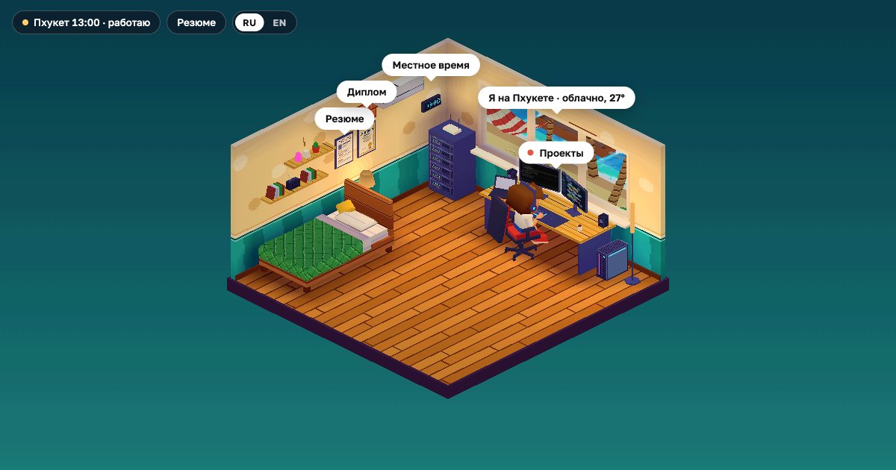

# donya.dev

**Live: <https://donya.dev>**

A portfolio as a place instead of a page: an isometric three.js room (PS1-style rendering, local time and weather in
Phuket, a talkie that gives a short tour) with a working Windows-XP-style desktop, "Windows XD", inside its monitor.
Sit down at the desk and the camera flies into the screen, which becomes a real DOM desktop with a window manager, a
Start menu and a dozen apps: projects, resume, Minesweeper, Paint, a browser.



This repository is a TypeScript port of my earlier version of the same site, which was a set of classic scripts glued
into one HTML file. That is why the history starts with an import and not with a first sketch.

## Decisions

- **No UI framework.** Plain TypeScript and a small DOM kit (`src/components/kit/kit.ts`). The desktop is a window manager
  and a set of small apps: a virtual DOM would add weight and a second source of truth for layout that the 3D hand-off
  reads straight from the DOM. Strict TypeScript (`noUncheckedIndexedAccess`, type-checked ESLint) does the job a
  framework's structure would.
- **three.js pinned at 0.128.** The look (materials, lights, the PS1 post pass with vertex snapping and dithering) is
  tuned to that version's renderer, and later versions changed colour management and lighting units. An upgrade means
  re-tuning every preset against the pixel harness, so it is deferred on purpose and the version is pinned exactly.
- **The model is one JSON request.** `public/room.json` is the Blender export quantized by gltfpack, gzipped and
  base64-encoded, inflated in the browser with `DecompressionStream`. One file that any static host or a single-file
  artifact can serve, fetched as `room.json?v=<content hash>` and cached for good.
- **The desktop loads after the room.** The room is the first paint; the desktop (about as much code again, mostly
  XP icon bitmaps) is a separate chunk fetched once the room is up, so it never delays the first frame.
- **A pixel-exact 3D → DOM hand-off.** The monitor in the scene shows a snapshot painted from the real desktop's DOM.
  At the end of the fly-in the canvas is swapped for the DOM desktop at the same pixels, so there is no visible cut.
- **A deterministic pixel regression harness.** The port had to keep every pixel, so `scripts/regress.mjs` freezes the
  clock, seeds `Math.random`, stubs the weather and captures 42 states in Chrome; `scripts/compare.mjs` diffs two
  captures. It caught, for example, a CSS minifier silently dropping `backdrop-filter`.
- **Two build targets.** `npm run build` makes the multi-file site; `npm run build:artifact` inlines everything into
  one `index.html`, because the same page is also published as a claude.ai artifact, which takes a single HTML file.
- **Fallbacks.** Without WebGL the page keeps its top bar and a plain projects button instead of an empty canvas
  (the desktop is DOM and still works); without JavaScript a `<noscript>` style makes the resume sheet the page. The
  resume is real markup in `index.html`, so it also prints.
- **One mute switch.** The room's music and the desktop's sounds share one setting (`src/store/sound.ts`), so
  muting in either place mutes both.

## Running

Node 24 (`nvm use` reads `.nvmrc`), then `npm ci`.

| Command                  | What                                                                           |
| ------------------------ | ------------------------------------------------------------------------------ |
| `npm run dev`            | dev server with hot reload                                                     |
| `npm run build`          | the multi-file site in `dist/`                                                 |
| `npm run build:artifact` | one self-contained `dist-artifact/index.html` (+ room.json, games/, wall/)     |
| `npm run preview`        | serve `dist/` (port 4173); `preview:artifact` serves `dist-artifact/`          |
| `npm run check`          | everything CI runs before the build: typecheck, lint, format check, tests      |
| `npm run typecheck`      | `tsc --noEmit`, strict, for the app and the typed scripts                      |
| `npm run lint`           | ESLint (typescript-eslint strict + stylistic, type-checked)                    |
| `npm run format`         | Prettier (`format:check` only checks)                                          |
| `npm test`               | Vitest: the DOM-free logic of the room, the desktop, the lab and the deploy    |
| `npm run regress`        | pixel regression capture; `npm run compare` diffs two captures                 |
| `npm run pack:room`      | re-pack `public/room.json` from a Blender export                               |
| `npm run deploy`         | check, build, upload `dist/` over FTP with TLS (`-- --dry-run` shows the plan) |

The harness, re-packing the model, deploying and the traps worth knowing are in
[docs/DEVELOPMENT.md](docs/DEVELOPMENT.md).

## Layout

```
index.html             page head and the room's markup (top bar, resume sheet)
src/
  main.ts              entry: the room first; the desktop is loaded once the room is up
  modules/             one folder per feature, each with an index.ts
    room/              the 3D room: scene/ (lights, weather, PS1 post pass), screens/, tour/, handoff/ (the
                       fly-in to the desktop), components/ (top bar, resume sheet, labels), store/, routes.ts
    desktop/           the Windows XD shell: windows/, taskbar/ (Start menu, tray), session/ (boot, sleep, shut
                       down), store/ (state, prefs, constants)
    apps/<name>/       the desktop's programs: projects, resume, about, contact, terminal, browser, notepad,
                       calculator, paint, minesweeper, recycle
    music/             the background lofi loop
  services/            *.service.ts: the room model, weather, Discord presence, the lazily loaded desktop
  store/               page-wide state: the one mute switch
  content/             texts: projects, resume, profile, stack
  components/kit/      the apps' small DOM kit (h(), menus, bindings)
  i18n/  types/  enums/  utils/  assets/
lab/music/         a NES-style synth sketch on Web Audio; dev only, not in the build
scripts/           deploy.mjs (FTP deploy), pack-room.mjs (Blender export -> room.json), regress.mjs + compare.mjs
public/            room.json, wallpapers, screenshots, music/ (the lofi loop, with its CREDITS.txt), .htaccess
docs/              DEVELOPMENT.md
```

## Credits

Third-party assets (the XP wallpapers and icons, game screenshots, the music, fonts, three.js) are listed in
[CREDITS.md](CREDITS.md).
